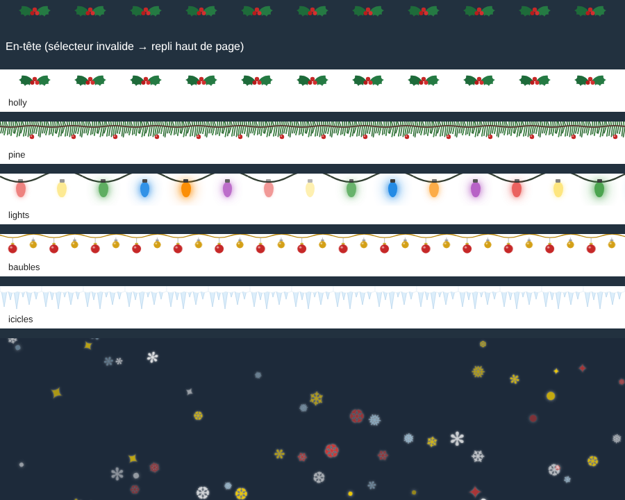
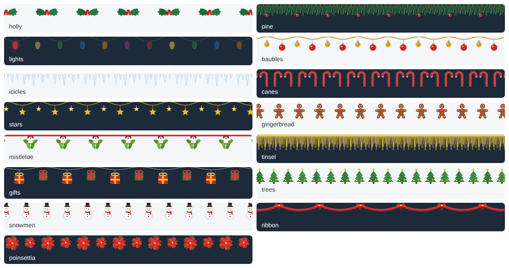
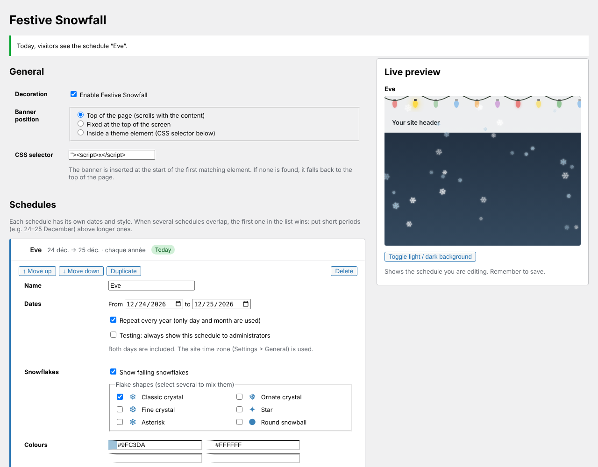

# Festive Snowfall

[🇬🇧 English version](README.md)

Extension WordPress légère qui ajoute des **flocons qui tombent** et une **bannière festive** sur votre site, avec des **programmations par date** : chaque période peut avoir son propre style.



## Fonctionnalités

- **Programmations** : jusqu'à 20 programmations, chacune avec ses dates **et** son style (flocons, couleurs, vitesse, bannière). Exemple : *Avent* avec du houx du 1er au 23 décembre, *Réveillon* avec la guirlande lumineuse les 24–25 décembre, *Nouvel An* avec des étoiles dorées du 31 décembre au 1er janvier.
- **Priorité** : si des programmations se chevauchent, la première de la liste l'emporte. Réordonnez-les avec *Monter / Descendre*.
- **Dates** : jour de début et de fin (inclus), répétables chaque année. Les périodes à cheval sur le Nouvel An sont gérées. Le fuseau horaire du site est utilisé.
- **6 types de flocons** à mélanger : cristal classique ❄, cristal orné ❅, cristal fin ❆, étoile ✦, astérisque ✻, boule de neige ●.
- **Jusqu'à 6 couleurs** par programmation ; chaque flocon en prend une au hasard.
- **Vitesse** de 1 (très lent) à 10 (très rapide), quantité (ordinateur et mobile) et tailles.
- **15 bannières de Noël** : houx, branches de sapin, guirlande lumineuse, boules, neige et glaçons, sucres d'orge, étoiles dorées, bonshommes en pain d'épices, gui, guirlande dorée, cadeaux suspendus, sapins, bonshommes de neige, ruban rouge et nœuds, poinsettias.
- **Position de la bannière** : haut de page, fixée en haut de l'écran, ou dans un élément du thème (sélecteur CSS).
- **Aperçu en direct** de la programmation en cours de modification, fond clair/sombre.
- **Mode test** par programmation : les administrateurs la voient quelle que soit la date ; les visiteurs ne sont pas concernés.
- Respecte `prefers-reduced-motion`, masqué à l'impression, éléments décoratifs en `aria-hidden`.
- **Mises à jour automatiques** depuis les releases GitHub (en un clic ou automatiques).
- Aucun pistage, aucune table en base. Fichiers chargés uniquement quand une programmation est active.
- Prête pour la traduction ; traduction française incluse.



## Prérequis

| | Minimum | Testé jusqu'à |
|---|---|---|
| WordPress | 6.3 | 7.1 |
| PHP | 7.4 | 8.4 |

## Installation

**Depuis une release (recommandé)**
1. Téléchargez `festive-snowfall.zip` sur la page [Releases](../../releases).
2. Dans WordPress : *Extensions → Ajouter → Téléverser une extension*, choisissez le ZIP puis *Activer*.

**Depuis les sources**
```bash
cd wp-content/plugins
git clone https://github.com/cedlelensois-lang/festive-snowfall.git
```

> Vous utilisiez *CGVL – Décor de Noël* : désactivez-la et supprimez-la d'abord. Mise à jour depuis Festive Snowfall 2.0 : vos réglages sont convertis automatiquement en une première programmation.

## Réglages

Rendez-vous dans **Réglages → Festive Snowfall**.

### Général

| Réglage | Remarques |
|---|---|
| Décor | Interrupteur général. |
| Position de la bannière | Haut de page / fixée / dans un sélecteur CSS (ex. `#header`, `.site-header`). Repli en haut de page si rien ne correspond. Commune à toutes les programmations. |

### Programmations

Chaque carte de programmation contient :

| Réglage | Remarques |
|---|---|
| Nom | Visible uniquement dans l'administration (ex. *Avent*). |
| Dates | Du / au, inclus. *Répéter chaque année* ne compare que le jour et le mois. |
| Test | Toujours affichée aux administrateurs (`manage_options`). Une seule programmation à la fois. |
| Flocons | Activés ou non, et types (cochez-en plusieurs pour les mélanger). |
| Couleurs | Jusqu'à 6 couleurs hexadécimales. |
| Vitesse | 1–10 → durée moyenne de chute ≈ 24 s à 4 s. |
| Quantité | 0–150 par type d'appareil ; 0 désactive la neige. |
| Taille | 4–60 px. |
| Style / hauteur de bannière | Un des 15 styles ou aucun ; 16–80 px. |

Boutons de chaque carte : **Monter**, **Descendre**, **Dupliquer**, **Supprimer**. Le badge **Aujourd'hui** indique la programmation que voient actuellement les visiteurs.



#### Exemple

| Ordre | Nom | Dates | Style |
|---|---|---|---|
| 1 | Réveillon | 24 déc. → 25 déc. | Guirlande lumineuse, flocons or et rouge, lent |
| 2 | Nouvel An | 31 déc. → 1er janv. | Étoiles dorées, flocons étoiles, rapide |
| 3 | Saison | 1er déc. → 6 janv. | Houx, cristaux blancs |

Le 24 décembre, *Réveillon* l'emporte car elle est placée au-dessus de *Saison*.

## Mises à jour

Les mises à jour viennent des **releases GitHub** de ce dépôt :

- WordPress vérifie la dernière release au plus toutes les 12 heures (avec cache ; en cas d'échec, nouvel essai après 1 heure). *Tableau de bord → Mises à jour → Vérifier à nouveau* ou le lien *Vérifier les mises à jour* dans la liste des extensions force la vérification.
- Une nouvelle version affiche la notification habituelle et s'installe en un clic. Activez les *mises à jour automatiques* sur la ligne de l'extension pour qu'elles s'installent seules.
- *Afficher les détails* présente les notes de version.
- Seul le fichier `festive-snowfall.zip` d'une release publiée (ni brouillon ni pré-version) de `cedlelensois-lang/festive-snowfall` est accepté.
- La seule requête externe est un appel à l'API publique de GitHub (`api.github.com`) ; aucune donnée sur votre site n'est envoyée. L'API GitHub sans authentification est limitée à 60 appels par heure et par IP de serveur, très au-dessus de ce qu'impose le cache de 12 heures.

> La version 2.1.0 n'a pas de module de mise à jour : installez la 2.1.1 manuellement une fois, ensuite les mises à jour sont automatiques.

Un fork peut pointer vers son propre dépôt :

```php
add_filter( 'festive_snowfall_update_repository', fn() => 'mon-compte/festive-snowfall' );
```

## Cache de pages

Les programmations sont évaluées **côté serveur**. Avec un cache de pages (WP Rocket, LiteSpeed Cache, W3 Total Cache, un CDN…), **videz-le à chaque date de changement de programmation**, sinon des visiteurs pourraient voir un style périmé.

## Pour les développeurs

```php
// Masquer le décor sur la page de paiement WooCommerce.
add_filter( 'festive_snowfall_should_display', function ( $display, $options ) {
    return ( function_exists( 'is_checkout' ) && is_checkout() ) ? false : $display;
}, 10, 2 );

// Modifier la programmation active (retourner null pour masquer).
add_filter( 'festive_snowfall_schedule', function ( $schedule, $options ) {
    if ( $schedule && is_front_page() ) {
        $schedule['count'] = 60; // Plus de neige sur l'accueil.
    }
    return $schedule;
}, 10, 2 );
```

Classes CSS : `.fesn-snow`, `.fesn-flake`, `.fesn-banner`, `.fesn-banner-{style}`, `.fesn-bulb`. L'élément `<html>` reçoit `fesn-active` pendant l'affichage.

Nom de l'option : `festive_snowfall_options` (supprimée à la désinstallation).

### Structure du projet

```
festive-snowfall.php                         Amorçage
includes/class-festive-snowfall.php          Modèle de réglages, migration, validation, choix de la programmation, fichiers front
includes/class-festive-snowfall-admin.php    Page de réglages
includes/class-festive-snowfall-period.php   Logique de période (PHP pur)
includes/class-festive-snowfall-updater.php  Mises à jour depuis les releases GitHub
assets/festive-snowfall.js|css               Rendu sur le site (également utilisé par l'aperçu)
assets/admin.js|css                          Cartes de programmation, couleurs, aperçu
languages/                                   Modèle .pot + traduction française
uninstall.php                                Suppression de l'option (compatible multisite)
tests/                                       Tests PHP sans dépendance
```

### Tests

```bash
php tests/period-test.php
php tests/plugin-test.php
php tests/updater-test.php
```

La CI les exécute sous PHP 7.4 → 8.4, vérifie la syntaxe JS et lance le [Plugin Check officiel de WordPress](https://github.com/WordPress/plugin-check-action).

### Publier une version

Mettez à jour le numéro de version dans `festive-snowfall.php` (en-tête **et** `FESN_VERSION`), `readme.txt` (`Stable tag`) et `CHANGELOG.md`, puis :

```bash
git tag v2.1.1 && git push origin v2.1.1
```

Le workflow de release construit `festive-snowfall.zip` (fichiers de développement exclus via `.gitattributes`) et l'attache à une release GitHub.

### Traductions

```bash
wp i18n make-pot . languages/festive-snowfall.pot --exclude=tests,docs
# modifiez languages/festive-snowfall-fr_FR.po (par ex. avec Poedit), puis :
wp i18n make-mo languages
```

## Sécurité

Voir [SECURITY.md](SECURITY.md).

## Licence

GPL-2.0 ou ultérieure. Voir [LICENSE](LICENSE).
