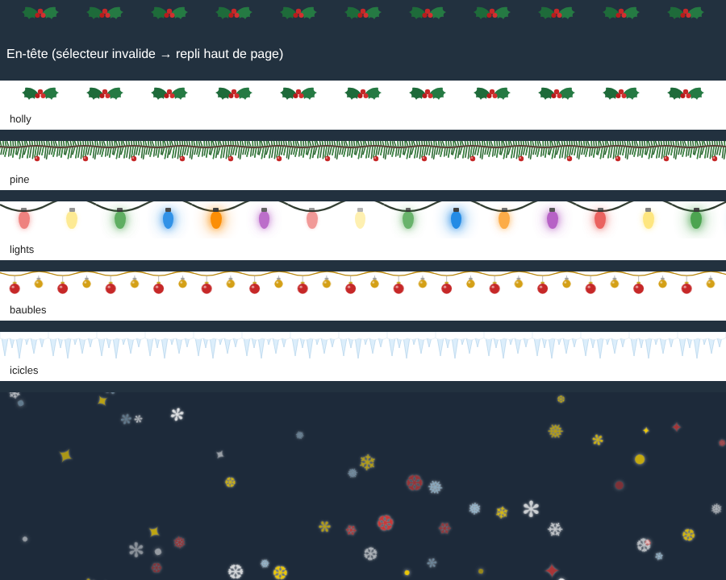
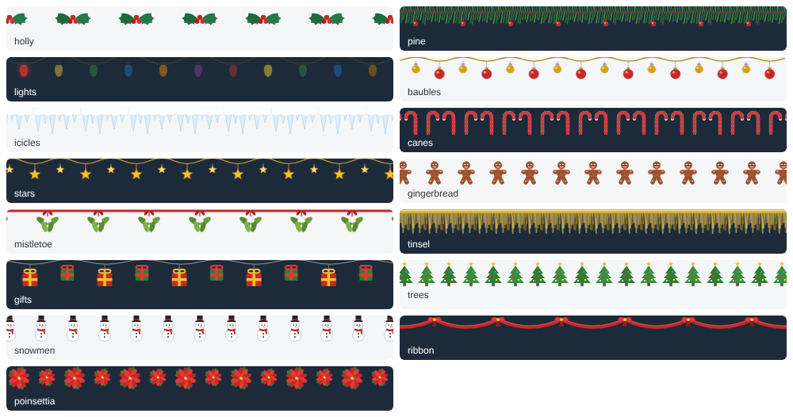
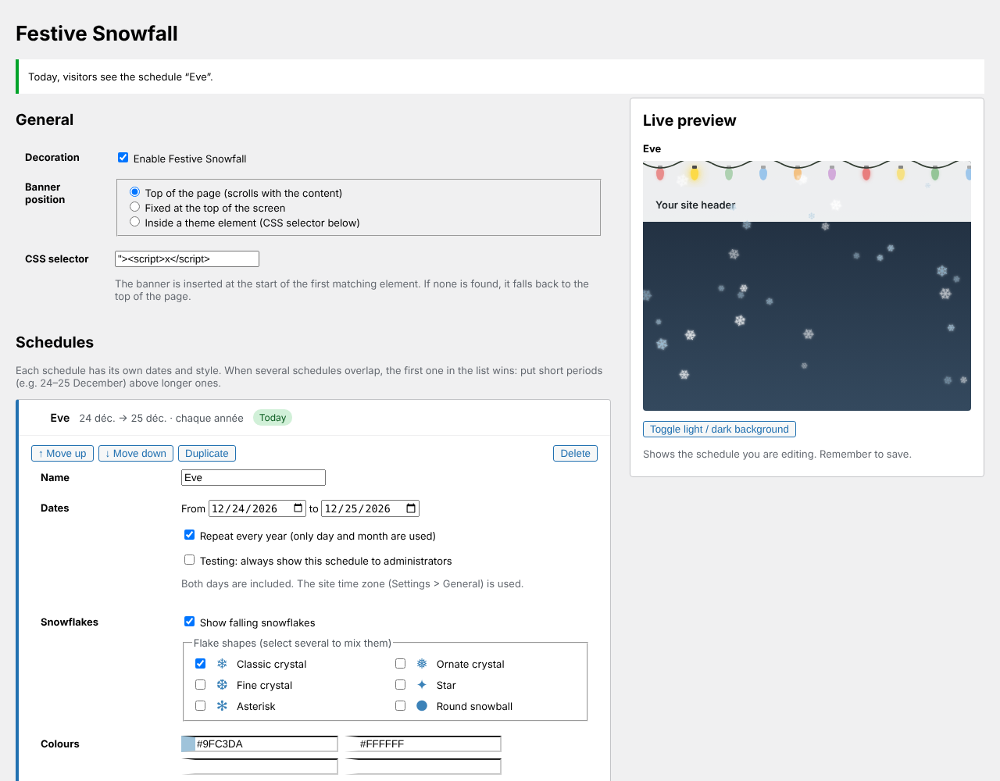

# Festive Snowfall

[🇫🇷 Version française](README.fr.md)

A lightweight WordPress plugin that adds **falling snowflakes** and a **festive banner** to your site, with **date-based schedules**: each period can have its own style.



## Features

- **Schedules**: create up to 20 schedules, each with its own dates **and** its own style (flakes, colours, speed, banner). Example: *Advent* with holly from 1 to 23 December, *Christmas Eve* with twinkling lights on 24–25 December, *New Year* with golden stars on 31 December – 1 January.
- **Priority**: when schedules overlap, the first one in the list wins. Reorder them with *Move up / Move down*.
- **Dates**: start and end day (inclusive), optionally repeated every year. Periods crossing New Year are supported. The site time zone is used.
- **6 flake shapes** you can mix: classic crystal ❄, ornate crystal ❅, fine crystal ❆, star ✦, asterisk ✻, round snowball ●.
- **Up to 6 colours** per schedule; each flake picks one at random.
- **Speed** from 1 (very slow) to 10 (very fast), quantity (desktop and mobile) and size range.
- **15 Christmas banners**: holly, pine branches, twinkling lights, baubles, snow and icicles, candy canes, golden stars, gingerbread men, mistletoe, gold tinsel, hanging gifts, Christmas trees, snowmen, red ribbon and bows, poinsettias.
- **Banner position**: top of the page, fixed at the top of the screen, or inside any theme element (CSS selector).
- **Live preview** of the schedule being edited, light/dark background.
- **Testing mode** per schedule: administrators see it whatever the date; visitors are not affected.
- Respects `prefers-reduced-motion`, hidden when printing, decorative elements are `aria-hidden`.
- No external requests, no tracking, no database tables. Assets load only when a schedule is active.
- Translation-ready; French translation included.



## Requirements

| | Minimum | Tested up to |
|---|---|---|
| WordPress | 6.3 | 7.1 |
| PHP | 7.4 | 8.4 |

## Installation

**From a release (recommended)**
1. Download `festive-snowfall.zip` from the [Releases](../../releases) page.
2. In WordPress: *Plugins → Add New → Upload Plugin*, choose the ZIP, then *Activate*.

**From source**
```bash
cd wp-content/plugins
git clone https://github.com/cedlelensois-lang/festive-snowfall.git
```

> Upgrading from *CGVL – Décor de Noël*: deactivate and delete it first. Upgrading from Festive Snowfall 2.0: your settings are converted automatically into a first schedule.

## Configuration

Go to **Settings → Festive Snowfall**.

### General

| Setting | Notes |
|---|---|
| Decoration | Master switch. |
| Banner position | Top of page / fixed / inside a CSS selector (e.g. `#header`, `.site-header`). Falls back to top of page if nothing matches. Shared by all schedules. |

### Schedules

Each schedule card contains:

| Setting | Notes |
|---|---|
| Name | Shown in the admin only (e.g. *Advent*). |
| Dates | From / to, both included. *Repeat every year* compares only day and month. |
| Testing | Always shown to administrators (`manage_options`). Only one schedule at a time. |
| Snowflakes | On/off and shapes (tick several to mix them). |
| Colours | Up to 6 hex colours. |
| Speed | 1–10 → average fall time ≈ 24 s to 4 s. |
| Quantity | 0–150 per device type; 0 disables snow. |
| Size | 4–60 px. |
| Banner style / height | One of 15 styles or none; 16–80 px. |

Buttons on each card: **Move up**, **Move down**, **Duplicate**, **Delete**. The badge **Today** shows which schedule visitors currently see.



#### Example

| Order | Name | Dates | Style |
|---|---|---|---|
| 1 | Christmas Eve | 24 Dec → 25 Dec | Light string, gold and red flakes, slow |
| 2 | New Year | 31 Dec → 1 Jan | Golden stars, star-shaped flakes, fast |
| 3 | Season | 1 Dec → 6 Jan | Holly, white crystals |

On 24 December the *Christmas Eve* schedule wins because it is listed above *Season*.

## Page caching

Schedules are evaluated **on the server**. If you use a page cache (WP Rocket, LiteSpeed Cache, W3 Total Cache, a CDN…), **purge it on every schedule change date**, otherwise visitors may see an outdated style.

## For developers

```php
// Hide the decoration on the WooCommerce checkout.
add_filter( 'festive_snowfall_should_display', function ( $display, $options ) {
    return ( function_exists( 'is_checkout' ) && is_checkout() ) ? false : $display;
}, 10, 2 );

// Change the active schedule (return null to hide).
add_filter( 'festive_snowfall_schedule', function ( $schedule, $options ) {
    if ( $schedule && is_front_page() ) {
        $schedule['count'] = 60; // More snow on the home page.
    }
    return $schedule;
}, 10, 2 );
```

CSS classes: `.fesn-snow`, `.fesn-flake`, `.fesn-banner`, `.fesn-banner-{style}`, `.fesn-bulb`. The `<html>` element gets `fesn-active` while the decoration is shown.

Option name: `festive_snowfall_options` (removed on uninstall).

### Project structure

```
festive-snowfall.php                         Bootstrap
includes/class-festive-snowfall.php          Settings model, migration, sanitization, schedule selection, front assets
includes/class-festive-snowfall-admin.php    Settings page
includes/class-festive-snowfall-period.php   Date period logic (pure PHP)
assets/festive-snowfall.js|css               Front-end rendering (also used by the preview)
assets/admin.js|css                          Schedule cards, colour pickers, live preview
languages/                                   .pot template + French translation
uninstall.php                                Removes the option (multisite aware)
tests/                                       Dependency-free PHP tests
```

### Tests

```bash
php tests/period-test.php
php tests/plugin-test.php
```

CI runs them on PHP 7.4 → 8.4, checks JS syntax and runs the official [WordPress Plugin Check](https://github.com/WordPress/plugin-check-action).

### Releasing

Bump the version in `festive-snowfall.php` (header **and** `FESN_VERSION`), `readme.txt` (`Stable tag`) and `CHANGELOG.md`, then:

```bash
git tag v2.1.0 && git push origin v2.1.0
```

The release workflow builds `festive-snowfall.zip` (development files excluded via `.gitattributes`) and attaches it to a GitHub release.

### Translations

```bash
wp i18n make-pot . languages/festive-snowfall.pot --exclude=tests,docs
# edit languages/festive-snowfall-fr_FR.po (e.g. with Poedit), then:
wp i18n make-mo languages
```

## Security

See [SECURITY.md](SECURITY.md).

## License

GPL-2.0-or-later. See [LICENSE](LICENSE).
